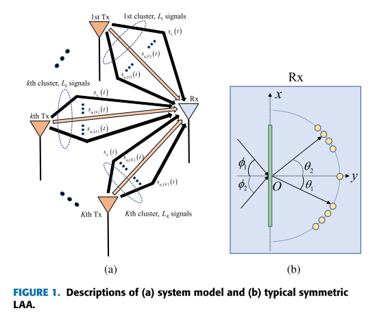
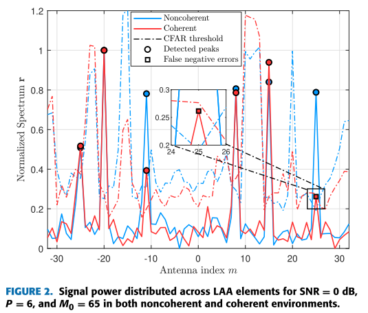
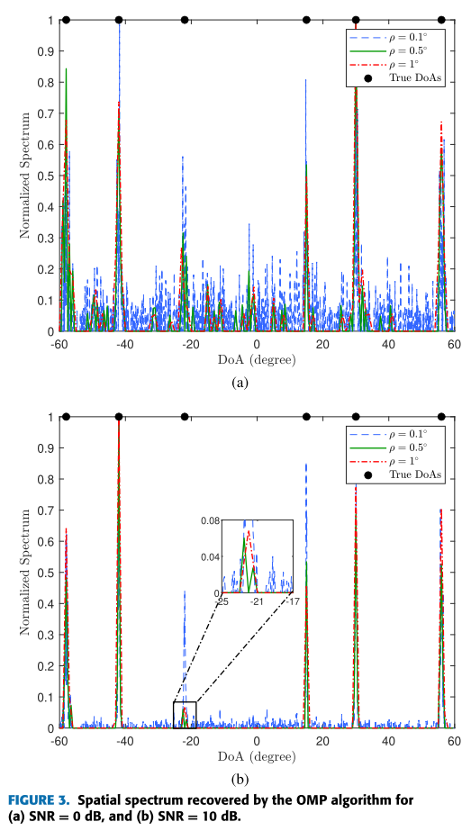
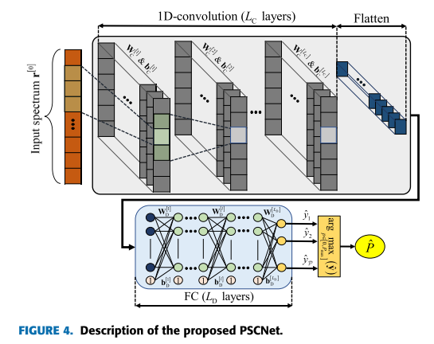
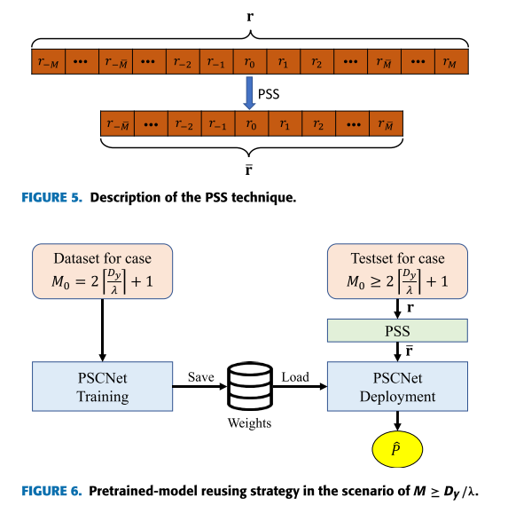
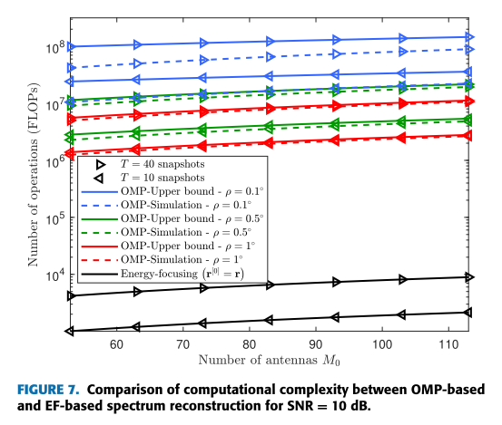
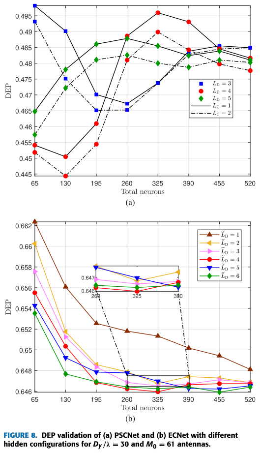
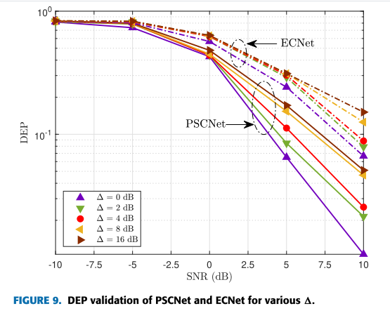
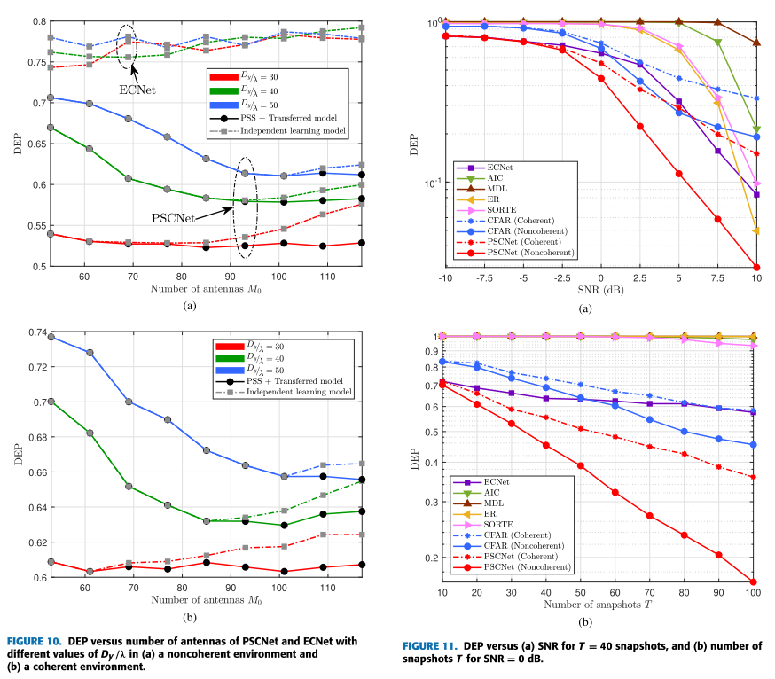

# [Source Estimate] Lens Antenna Array Signal Counting Based on Deep Learning [Attached Code]

Introduction
The power focusing characteristics of electromagnetic (EM) lenses make lens antenna arrays (LAA) one of the most promising technologies for reducing hardware costs and signal processing complexity in large-scale multiinput multioutput (MIMO) systems and millimeter wave communication [1]. The energy of received signals is concentrated on subsets of array elements, which can then be distinguished and connected to a limited number of RF chains. Therefore, accurately identifying the beam from the transmitter and precisely estimating the direction of arrival (DoA) is crucial. Various DoA estimation strategies have been reported recently [2] and [3]. A three-step algorithm based on a class of MUSIC called root MUSIC has been proposed for estimating DoA in scenarios with completely uncorrelated signals [2]. Research [3] investigated path number detection while proposing a signal direction estimator that takes into account the power leakage phenomenon of LAA. However, the input signal's coherence was overlooked when they are highly correlated, leading to significant difficulties. The preprocessing stage is crucial in handling coherently received signals, as reflected components are combined into direct components, resulting in an insufficient rank of the signal subspace. Spatial smoothing techniques such as forward/backward spatial smoothing (FBSS) algorithms [4], [5], [6] and full row Toeplitz matrix reconstruction (FTMR) [7], [8], [9] in the rotation-invariant technology (ESPRIT) family [10], [11], [12] are effective preprocessing tools to avoid the problem of coherent signals. However, it should be emphasized that these methods were applied when linear antenna arrays were used, without research on direction estimation aided by LAA. For example, each complex value element of the steering matrix for uniform linear arrays (UWB) can be represented as an exponential form. On the other hand, the array response of antennas in LAA follows a "sinc" function [1], which cannot form a modified steering matrix Vandermonde structure in the output matrix of FBSS or FTMR. As a result, the smooth covariance matrix of LAA has full rank, making it impossible to distinguish between signal and noise eigenvalues. In other words, spatial smoothing methods cannot de-correlate the coherent signals received by LAA.
Existing works on DOA (Direction of Arrival) [1], [2], [3], [4], [7], [11], [12] mostly rely on subspace-based array processing algorithms, which share a common drawback: they require prior knowledge of the number of signals as a prerequisite. In contrast to subspace-based methods, Compressed Sensing (CS) addresses the problem of coherent DoA estimation without the need for prior knowledge of signal numbers. This method can reconstruct the spatial spectrum based on the sparsity of non-zero terms in the array signal's angle space. In the variant of CS sparse signal recovery, Orthogonal Matching Pursuit (OMP) has notably lower computational complexity and higher restoration speed; therefore, it is an appropriate choice for signal enumeration and direction approximation [15], [16]. However, OMP is susceptible to noise signals and multipath distortions. As a result, combining CS-aided estimates with sharp peak detectors may lead to a significant detection error probability for signal number detection.
The signal counting problem has been studied for several signal processing and wireless communication applications. The most commonly used technique is the measurement of the difference between two consecutive feature values, such as the Akaike Information Criterion (AIC) [17] and the Minimum Description Length (MDL) [18]. Additionally, the use of second-order statistical measures of feature values (SORTE) [19] and feature ratios (ER) [20] to enhance traditional detection capabilities. Furthermore, two deep learning (DL) auxiliary detectors, called ECNet and ERNet, have been introduced to overcome severe performance degradation in some challenging scenarios, including low Signal-to-Noise Ratio (SNR) and limited number of snapshots. However, the physical structure of LAA differs from that of classical LFM, hindering the implementation of these algorithms and other support for dimensionality reduction methods in consistent scenarios. Moreover, the Eigenvalue Decomposition (EVD) with complex-valued matrices generates a significant computational burden, typically contributing about half of the total complexity of these subspace-based algorithms. To alleviate the computational demands of the aforementioned data preprocessing steps, the signal power distribution across LAA elements can be used as an alternative solution to EVD. This functionality can then be combined with a simple peak detection mechanism, such as the Constant False Alarm Rate (CFAR) scheme [22], to count the number of incoming signals. However, CFAR detectors require several parameters to be configured, such as the number of training units, the number of protection units, and the false alarm probability for operation. It is noteworthy that the values of these configuration parameters affect the performance of the CFAR detector. Finally, angle blur affects the signal counting performance of spectrum-aided and subspace fitting algorithms. Accurately, representing peaks in the EF spectrum of adjacent antennas may merge into one, which hinders peak finding algorithms like CFAR. Additionally, angle blur leads to degeneracy of the steering vectors, approximated as linear combinations of other steering vectors [23]. This undesirable phenomenon results in failures of feature-based schemes. These issues have motivated the proposal of an effective signal enumeration algorithm for LAA in this work. The contributions of this work are as follows:
· Proposed a Power Spectrum-based Convolutional Neural Network (PSCNet) that leverages the Energy Focusing (EF) characteristic of LAA for high signal counting precision without assigning any configuration parameters. Simulation results show that PSCNet not only outperforms detectors based on feature value gap and constant false alarm rate in adverse conditions such as severe environmental pollution or limited sample size, but also enhances the enumeration capability under manifold blurring scenarios.
· Analyzed the input power spectrum to demonstrate its adaptability to both non-coherent and coherent scenes. Moreover, it has been mathematically proven that the proposed PSCNet has lower computational complexity than the state-of-the-art subspace-based algorithms and OMP-aided path number detectors in the current literature.
· Employed Power Spectrum Shortening (PSS) technology as an input transformation method, which eliminates some rich elements in the original spectrum, allowing the transformed model to be reused effectively for predicting the number of signals. Additionally, a model reuse strategy was proposed to save training time and computational resources, as well as achieve better performance compared to traditional single-task learning models.
Article illustrations
Conclusion
In this paper, we propose a new CNN-based symmetric LAA signal counting scheme. The power spectrum formed by energy distributed on antenna elements is used for both non-coherent and coherent scenes. The proposed PSCNet employs several 1D convolutional layers to extract features from the input spectrum and generates a one-hot vector representing the count of collision signals. Furthermore, the PSS technique maintains the size of the input features, allowing the reused model to be applied regardless of the number of antennas. This saves computational resources in actual deployment and reduces training time. Compared to its predecessors [17], [18], [19], [20], [21], the proposed detector provides more reliable performance with lower computational complexity. Finally, based on numerical simulations and analysis results, we can conclude that a large-scale LAA system with extensive normalization lens sizes can achieve more reliable signal counting performance.

## Images

<!-- PAYMENT_BLOCK -->

## Get this dataset

- Payment link (Stripe): [Buy now](https://buy.stripe.com/3cs8yP7sY87d0vu9AB)
- Payment QR code: 

<!-- /PAYMENT_BLOCK -->
